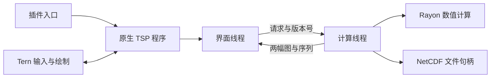

# DataBlender 设计

这个插件显示并处理科学数据网格场（NetCDF、HDF5、MATLAB）。`window.luau` 启动随包分发的 `tern-datablender` 原生程序，程序通过 Tern Surface Protocol（TSP）显示界面。

## 进程与线程



界面线程只处理输入、编辑器、视图和计算结果。NetCDF 读取、处理图求值、Rayon 计算和 PNG 编码都在计算线程运行。文件句柄随程序保留，避免每次操作重新打开文件。

## 前后对照

界面按处理前与处理后组织。顶部主体从左向右依次为输入变量列表、原始场、结果场和结果变量列表。两幅图下方分别放切片、坐标与幅度控件。底部左侧是预定义操作树，右侧是脚本管线。

输入变量与结果变量分别选择。`Project.source_variable` 指定左图的原始变量。右侧默认显示脚本通过 `show` 与 `arrows` 定义的合成图。`Project.result_variable` 可以改为脚本中命名的标量或向量，以检查中间结果。向量选择显示模长和箭头。

`Project.slice` 指定结果切片。`source_slice = null` 让左图使用相同切片。独立切片保存在 `source_slice` 中。两幅图的色标范围分别保存在 `source_range` 和 `result_range`。原始图像按变量、切片和色标缓存；修改脚本复用这幅图像。

## 节点图与多变量混合架构

界面全面迁移至可视化节点图 `NodeGraph`，由节点集合 `Vec<GraphNode>` 与图层栈 `Vec<GraphLayer>` 构成。

1. **节点拓扑与编译**：
   `GraphNode` 定义了唯一标识 `id`、名称、坐标及输入连接槽 `inputs: Vec<Option<u64>>`。算子覆盖 `Source`、`Gaussian`、`Convolve`、`Difference`、`Scale`、`Gradient`、`Vector` 与 `Magnitude`。`NodeGraph::compile()` 使用深度优先搜索（DFS）进行拓扑展开与求值，并内置环路检测（Cycle Detection）。

2. **多变量 Alpha 混合**：
   `GraphLayer` 指定了关联节点、显隐状态、色标（Viridis、Thermal、Diverging、Gray）、不透明度（0.0～1.0）及显示色标范围。渲染器在 Rayon 并行行处理循环中按图层顺序执行 Alpha 合成：
   $$C_{\text{out}} = C_{\text{layer}} \cdot \alpha + C_{\text{base}} \cdot (1 - \alpha)$$
   底层至顶层逐层叠加，使得不同变量（如海表温度背景叠加流速大小与矢量箭头）能够在同一视口中融合对比。

3. **独立 Python 代码导出**：
   `native/src/python.rs` 将当前视口中的 `NodeGraph` 编译为原生 Python 脚本。脚本基于 `xarray` 读取 NetCDF 数据并解压坐标，使用 `scipy.ndimage` 模拟带有效点重归一化的反射边界高斯滤波与卷积，使用 NumPy 实现非均匀梯度导数计算，并用 Matplotlib 执行图层混合与 Quiver 箭头绘制。代码不含占位符，支持通过命令行参数批量运行。

标量场与向量场是不同的 Rust 类型。一个标量场持有二维 `f32` 数组、两个一维坐标轴和单位。一个向量场持有两个标量分量。数据与坐标通过 `Arc` 共享。

求值器按节点内容和切片缓存结果。缓存容量按数值数组字节数限制为 128 MiB，按插入顺序驱逐。文件路径、大小或修改时间变化时，计算线程重新打开文件并清空缓存。结果列表来自脚本作用域中的场变量；生成列表不计算每个中间变量。

每个预览有递增版本号。新预览覆盖尚未执行的预览，并使旧版本失效。Rayon 算子在每行开始时检查版本。已经进入 NetCDF-C 的调用在返回后检查版本。界面丢弃旧预览结果。导出使用独立队列，保留用户明确提交的操作。

## NetCDF 与数值语义

`netcdf-rs` 静态编入 NetCDF-C、HDF5 和 zlib。一个计算线程持有文件句柄。C 库访问经过 crate 的全局锁。读出的平面进入普通 Rust 数组后，Rayon 并行执行算子。

读取器使用维度切片，只提取选择的二维平面。它支持经典 NetCDF 和 NetCDF-4、数值变量、分组路径、维度转置及一维坐标。轴优先根据 CF 属性和维度名选择，其余情况使用最后两个维度。缺少一维坐标时，轴使用索引，并保留空单位。二维曲线网格坐标不会被投影。

`_FillValue` 和 `missing_value` 在打包值域中处理，随后应用 `scale_factor` 与 `add_offset`。非有限值成为 NaN。处理数组使用 `f32`，坐标使用 `f64`。读取器不使用 `valid_min`、`valid_max` 或 `valid_range` 裁剪数据；样例文件的浮点变量携带了旧整数编码的范围属性。

| 算子 | 数值含义 |
| --- | --- |
| `gaussian(a, sigma)` | 标准差以网格单元计。半径为 `ceil(3*sigma)`，边缘镜像；有效邻点重新归一化，原有缺测中心保持缺测。 |
| `convolve(a, weights)` | 奇数阶方形卷积，边缘镜像，使用原始权重。非零权重涉及缺测值时，结果缺测。 |
| `difference(a, b)` | 逐点相减，要求相同坐标和单位。 |
| `scale(a, factor, offset)` | 逐点执行 `a*factor+offset`，保留单位文本。 |
| `gradient(a)` | 按真实一维坐标间距求导，内部使用非均匀三点公式，边界使用单边差分。 |
| `vector(u, v)` | 组合相同坐标和单位的两个分量。 |
| `magnitude(v)` | 计算 `hypot(u,v)`，要求两个分量单位一致。 |

经纬度梯度的单位是原变量单位除以度。它没有进行球面距离换算。任意非均匀坐标上的导数使用坐标间距；图像像素按网格索引等距排列。

## 渲染与协议边界

渲染器按图层顺序执行透明度合成，并在数值网格上抽样绘制箭头。正方向随坐标增加，图像显示为 x 向右、y 向上。存储顺序倒置只改变像素位置。箭头长度按当前抽样点的最大向量模长归一化。

图像最长边限制为 1536 像素。完整数值平面保留给坐标读数和 NetCDF 导出。PNG 在内存中编码，直接通过 TSP blob 传输。Tern 负责图像显示、控件布局和编辑器绘制。

TSP 的动作事件没有任意鼠标坐标，也没有滚轮或拖拽事件。每幅图覆盖一层 16×16 的透明格网，格网单元是图像的子节点。悬停提示使用当前平面的采样值、单位和坐标，通过 CSS 显示。点击一格将采样点索引写入 x / y，并请求该点沿帧维的序列。提示中的坐标标明格内实际采样位置。序列在左图下方画成 64 格字符条，点一格跳到对应帧。坐标输入、播放与单帧按钮仍然保留。握手只提供列数和单元格尺寸，因此界面布局使用弹性区域，图像按可用高度铺满画布。

预览请求进行时界面继续显示上一帧，完成结果直接替换，不插入占位画面。图像 blob 在上传成功后才切换，上传失败保留旧图像。

## 持久化与发行

项目 JSON 保存源路径、脚本、变量选择、切片、色标和点选位置。插件为新窗格分配项目路径，并提供恢复最近项目的命令。自动保存写入同目录的临时文件后原子替换。导出 PNG、NetCDF 时要求目标文件尚不存在。

每个平台的发行目录结构相同：

```
plugin.toml
window.luau
bin/tern-datablender
README.md
DESIGN.md
```

Windows 使用 `tern-datablender.exe`。构建脚本在对应平台编译、签名并打包。构建环境需要 Rust、C/C++ 编译器和 CMake；运行环境只需要 Tern 与随包二进制。

## 源码边界

| 文件 | 职责 |
| --- | --- |
| `window.luau` | 命令面板、文件路由、原生程序启动。 |
| `native/src/model.rs` | 项目、场、处理图与结果数据类型。 |
| `native/src/graph.rs` | Rhai 场表达式、节点求值和数组缓存。 |
| `native/src/kernels.rs` | Rayon 滤波、卷积、差分、梯度与向量模长。 |
| `native/src/netcdf_io.rs` | NetCDF 元数据、平面读取、坐标解码和导出。 |
| `native/src/hdf5_io.rs` | HDF5 数据集元数据、切片与多维张量读取。 |
| `native/src/mat_io.rs` | MATLAB v5 与 v7.3 格式解析。 |
| `native/src/dataset.rs` | 统一数据集分发接口。 |
| `native/src/render.rs` | 色标、图层合成、箭头与 PNG 编码。 |
| `native/src/python.rs` | 独立 Python 可视化代码生成引擎。 |
| `native/src/runtime.rs` | 持久句柄、预览版本、导出队列和前后视图。 |
| `native/src/ui.rs` | TSP 界面、编辑器状态和用户操作。 |
| `native/src/main.rs` | 交互界面与命令行入口。 |
| `native/ui.css` | 屏幕界面的布局与控件样式。 |
| `scripts/package.sh` / `package.ps1` | 平台构建与发行包。 |
