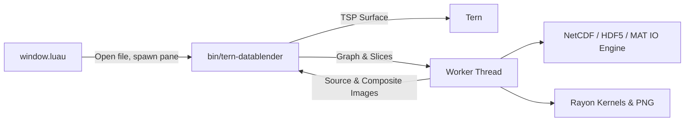

# tern-datablender

Scientific field visualization and node-graph blending plugin for Tern (supporting NetCDF, HDF5, and MATLAB formats). Computation runs in an embedded Rust binary, with visual controls and layouts rendered via the Tern Surface Protocol (TSP).

[English](README.en.md) | [中文](README.md)




## Features

- **Multi-Format Support**: Reads classic NetCDF, NetCDF-4, HDF5 (`.h5`, `.hdf5`), MATLAB v5 and v7.3 (`.mat`).
- **Visual Node Graph**: Build processing pipelines without code. Connect nodes by selecting output (`Output →`) and input ports (`A ←`, `B ←`).
- **Operators**: Includes `Gaussian blur`, `Mean convolution`, `Difference (A − B)`, `Addition (A + B)`, `Scale & offset`, `Filter · Range [min, max]`, `Median filter`, `2D FFT · Spectrum`, `2D IFFT · Inverse`, `Gradient`, `Vector (U + V)`, `Magnitude`, and `t+n · Time shift`.
- **Multi-Variable Layer Blending**: Layer multiple variables and derived fields in a compositing stack. Each layer independently configures its visibility (`Hide` / `Show`), removal (`Remove`), colormap, opacity, and z-order.
- **Probe Grid & Time Series**: A 16×16 lattice covers each field. Hover over a cell to see its sampled value, units, and coordinates. Click to select that sample and retrieve its series. The tooltip identifies the actual sampled position.
- **Python Export**: One-click generation of standalone Python scripts based on `xarray`, `numpy`, `scipy.ndimage`, and `matplotlib`. Reproduces the exact graph topology, slices, colormaps, opacity blend, and vector arrows offline.

## Installation

Pre-built binaries statically link NetCDF-C, HDF5, and zlib; no external C libraries are required at runtime.

```sh
# Build package from source (requires Rust, C/C++ compiler, CMake)
scripts/package.sh                    # macOS / Linux
scripts/package.ps1                   # Windows
# Output: dist/tern-datablender-<target>/ and .tar.gz / .zip

tern plugin install <directory or git URL>
tern plugin list                      # Shows tern-datablender ready
```

## Usage

In Tern, open the command palette (`Ctrl+Shift+P` / `Cmd+Shift+P`) and execute **"DataBlender: Open data file"**, then enter a `.nc`, `.nc4`, `.cdf`, `.mat`, `.h5`, or `.hdf5` path. The plugin also handles file opens from the file manager, terminal commands (`tern open <file.h5>`), and Finder drag-and-drop.

HDF5 arrays with four dimensions default to `[sample, lat, lon, channel]`, as used by the GLORYS patch dataset. Axes use array indices when coordinate data is absent.

### Workspace Layout

- **Source Variables (Left Rail)**: Lists variables in the dataset. Each variable card shows the variable name, wrapped dimension tags (e.g. `sample: 10000`, `time: 365`, `latitude: 121`), and units. Click `+ Node` to add the variable to the graph.
- **Dual Viewports (Center)**: Left pane displays the raw source field; right pane displays the pipeline composite.
- **Layers Stack (Right Rail)**: Manage active layers. Toggle visibility, switch colormaps, adjust opacity sliders, and reorder layers (`↑` / `↓`).
- **Operator Library (Bottom Left)**: Quick-add operation nodes and access export buttons (Python, PNG, NetCDF).
- **Processing Graph (Bottom Right)**: Interactive node workspace showing connected upstream dependencies, numerical parameters (e.g. $\sigma$, scale factors), and layer controls.

### Temporal differences

The `t+n` node shifts its input by n frames, with n=1 by default. Use − / + to select positive, zero, or negative offsets. Connect the shifted field to Difference input A and the original field to input B to compute `A(t+n) − A(t)`. Offsets count dataset frames. Frames outside the time range contain missing values.

## File Structure

| Path | Purpose |
| --- | --- |
| `plugin.toml` | Manifest: ID `tern-datablender`, window entry |
| `window.luau` | Command palette, file route handlers, process launcher |
| `native/src/model.rs` | Node graph, layers, project, and field data types |
| `native/src/kernels.rs` | Rayon parallel kernels (filter, convolve, gradient, vectors) |
| `native/src/netcdf_io.rs` | NetCDF C reader, slice decoders, grid export |
| `native/src/hdf5_io.rs` | Native HDF5 dataset reader and slice extraction |
| `native/src/mat_io.rs` | MATLAB v5 and v7.3 file parsers |
| `native/src/dataset.rs` | Unified dataset loader dispatching across NetCDF, HDF5, and MAT |
| `native/src/render.rs` | Colormaps, alpha blending, quiver arrows, and PNG encoder |
| `native/src/python.rs` | Standalone Python export generator |
| `native/src/runtime.rs` | Background engine worker, debounce, and preview versions |
| `native/src/ui.rs` | TSP node interface, events, and state machine |
| `native/src/main.rs` | Entry point for CLI and interactive surface |
| `native/ui.css` | Surface layout and visual styles |
| `scripts/package.sh` | Unix build and packaging script |
| `scripts/package.ps1` | Windows PowerShell build and packaging script |
| `data/sample_ocean.nc` | Sample 3D ocean velocity field (365×121×121) |
| `data/glorys1997_ocean_128.h5` | Local GLORYS HDF5 patches (10000×128×128×1/2, supplied separately) |

## Supported Platforms

- macOS arm64 (`aarch64-apple-darwin`)
- macOS x86_64 (`x86_64-apple-darwin`)
- Linux x86_64 (`x86_64-unknown-linux-gnu`)
- Windows x86_64 (`x86_64-pc-windows-msvc`)
