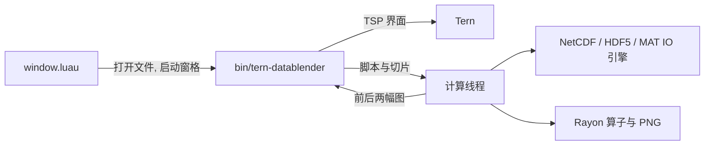

# tern-datablender

Tern 里的科学数据场查看与节点式混合处理插件（支持 NetCDF、HDF5 与 MATLAB 格式）。计算在随插件分发的 Rust 程序中进行，界面通过 Tern Surface Protocol 显示。

[English](README.en.md) | [中文](README.md)




## 安装

每个平台一个目录，内含已编译的 `bin/tern-datablender`。NetCDF、HDF5 与 zlib 已静态编入，运行时不需安装这些库。

```sh
# 源码构建打包（构建机需要 Rust、C/C++ 与 CMake）
scripts/package.sh                    # macOS / Linux
scripts/package.ps1                   # Windows
# 产物: dist/tern-datablender-<target>/ 与同名 .tar.gz 或 .zip

tern plugin install <解包目录或 Git 地址>
tern plugin list                      # 显示 tern-datablender ready
```

下载发行包时，选择与本机匹配的目标三元组，解包后用 `tern plugin install <目录>` 安装。

## 使用

命令面板执行 "DataBlender: Open data file"，输入 `.nc`、`.nc4`、`.cdf`、`.mat`、`.h5` 或 `.hdf5` 路径。插件注册了这些扩展名的打开路由：在文件面板、Finder 拖放、`tern open` 或命令面板打开时，都会启动原生查看器，不再落到十六进制编辑器。`DataBlender: New workspace` 建立空项目，`DataBlender: Resume last project` 恢复上一个项目。

界面按可视化数据流组织：

1. **输入变量列表（左侧）**：列出数据集变量。每个变量卡片独立展示名称、维度标签（如 `sample: 10000`、`time: 365`、`latitude: 121`）和单位，标签自适应换行，点击 `+ Node` 直接将该变量作为源节点添加到处理节点图中。
2. **双场对比区（中间）**：左图显示原始场，右图显示经节点图处理与图层合成后的复合场。两图均覆盖 16×16 探针网格。悬停显示当前格内采样点的数值、单位与坐标，点击选择该点并读取序列。提示中的坐标标明实际采样位置。
3. **多图层混合栈（右侧）**：支持将任意节点加入图层。每个图层提供 `Hide` / `Show` 显隐切换、`Remove` 图层删除、独立色标切换、透明度微调以及上下图层移序。多变量在像素级按 Alpha 混合呈现。
4. **操作算子库（底部左侧）**：提供 `Gaussian blur`、`Mean convolution`、`Difference (A − B)`、`Addition (A + B)`、`Scale & offset`、`Filter · Range [min, max]`、`Median filter`、`2D FFT · Spectrum`、`2D IFFT · Inverse`、`Gradient`、`Vector (U + V)`、`Magnitude` 和 `t+n · Time shift` 算子节点，以及导出面板。
5. **节点图画布（底部右侧）**：免代码的流式节点工作台。每个节点具备清晰的输入端口（`A ←`、`B ←`）与输出端口（`Output →`），支持参数微调步进（如高斯 $\sigma$、缩放因数与偏置）与连线环路自动检测。

### 时序与样本差分

时序差分节点（`t+n`）支持在同变量的时序维度（或样本维度）上指定整数步进 $\Delta t$。步进 $\Delta t > 0$ 时读取未来场，$\Delta t < 0$ 时读取历史场，越界部分填充缺测值（NaN），便于对流速变化率或多时步涡旋演变进行分析。

## 数据边界与格式支持

- **NetCDF、HDF5 与 MATLAB 数据源**：支持经典 NetCDF、NetCDF-4、HDF5（`.h5` / `.hdf5`）、MATLAB Level 5 / v7 压缩 `.mat` 文件以及 MATLAB v7.3 / HDF5 `.mat` 文件。自动解析二维与多维实数矩阵、坐标轴与切片。
- HDF5 四维数组默认按 `[sample, lat, lon, channel]` 解释，适用于 GLORYS patch 数据。缺少坐标数据时，轴值使用数组索引。
- `_FillValue` 与 `missing_value` 处理为缺测，`valid_min` 等属性不参与裁剪。
- 图像最长边 1536 像素；更大的网格降采样显示，导出 NetCDF 保留完整精度。
- 导出 PNG 与 NetCDF 要求目标文件不存在。项目 JSON 记录路径、脚本、变量、切片与色标。
- TSP 不提供鼠标坐标、滚轮与拖拽事件；点选、缩放和平移使用格网、控件与键盘。

## 文件

| 路径 | 作用 |
| --- | --- |
| `plugin.toml` | 清单：id `tern-datablender`，窗口入口 |
| `window.luau` | 命令面板、文件打开路由、原生程序启动 |
| `native/src/model.rs` | 项目、场、处理图与结果数据类型 |
| `native/src/graph.rs` | Rhai 场表达式、节点求值和数组缓存 |
| `native/src/kernels.rs` | Rayon 滤波、卷积、差分、梯度与向量模长 |
| `native/src/netcdf_io.rs` | NetCDF 元数据、平面读取、坐标解码和导出 |
| `native/src/hdf5_io.rs` | HDF5 元数据、切片提取、多维特征处理 |
| `native/src/mat_io.rs` | MATLAB v5 与 v7.3 解析 |
| `native/src/dataset.rs` | 统一数据接口与多格式分发 |
| `native/src/render.rs` | 色标、图层合成、箭头与 PNG 编码 |
| `native/src/python.rs` | 独立 Python 可视化代码生成引擎 |
| `native/src/runtime.rs` | 持久句柄、预览版本、导出队列和前后视图 |
| `native/src/ui.rs` | TSP 界面、编辑器状态和用户操作 |
| `native/src/main.rs` | 交互界面与命令行入口 |
| `native/ui.css` | 屏幕界面的布局与控件样式 |
| `scripts/package.sh` / `package.ps1` | 本平台打包脚本 |
| `data/sample_ocean.nc` | 样例 NetCDF 场（365×121×121） |
| `data/glorys1997_ocean_128.h5` | 本地 HDF5 海洋场（10000×128×128×1/2，数据文件单独准备） |

## 平台范围

本仓库验证的平台为 macOS arm64。Linux 与 Windows 由对应构建脚本在各自平台产出；跨平台构建需要该目标的 Rust 工具链与 C/C++ 构建环境。
